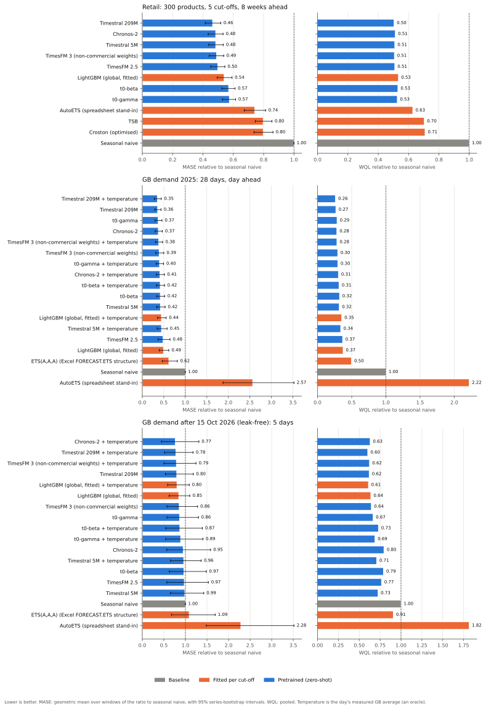
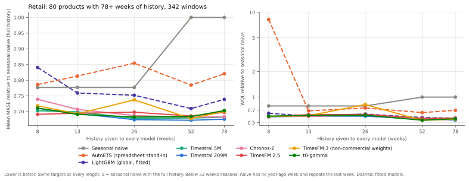
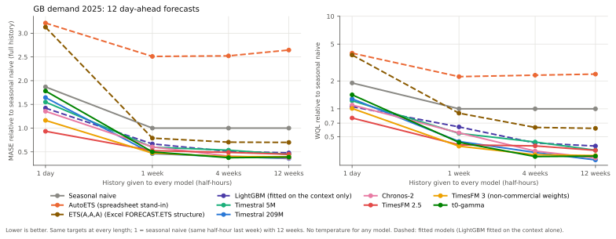
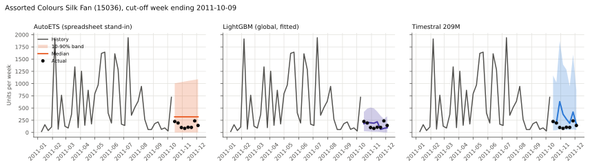
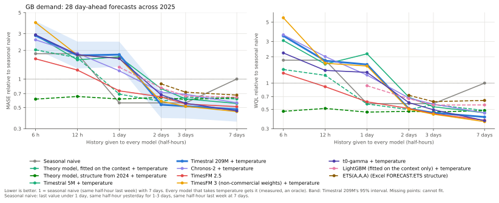
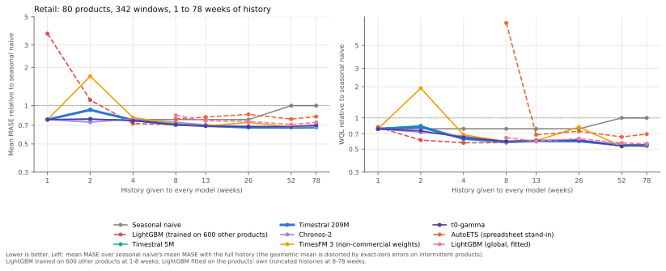
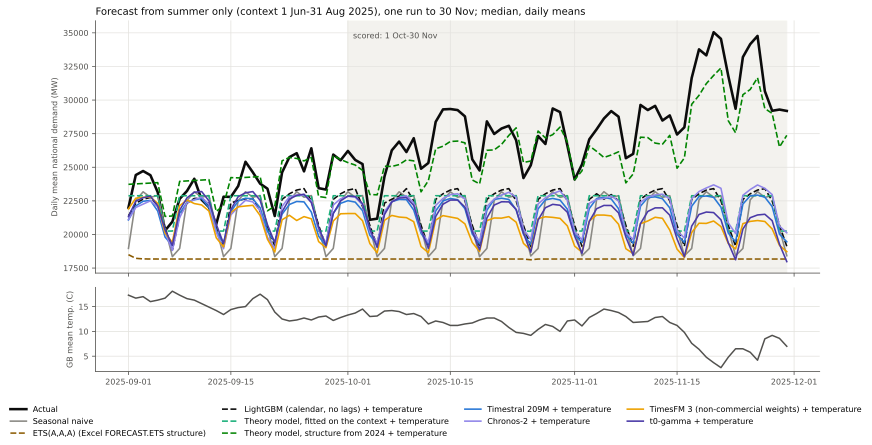

# demand-forecasting-benchmark

Pretrained forecasters against the models a planner already has, on two kinds of public
demand data. Companion code for the Winder.AI article *Timestral Tested: AI Demand
Forecasting vs Your Spreadsheet*, published so that its numbers can be re-run rather than
believed. Every forecast the article reports is in `results/forecasts/`, and every number in
its tables comes out of `results/summary.json`.

- **Data:** weekly units for an online gift retailer (UCI Online Retail II, 2009-2011), and
  half-hourly GB national electricity demand (NESO), including the days after Timestral's
  release on 15 October 2026, which no model released before then can have seen. A small
  promotion test on FreshRetailNet-50K is the third.
- **Pretrained (zero-shot):** Timestral 5M and 209M (Mistral AI), Chronos-2 (Amazon),
  TimesFM 2.5 and TimesFM 3 (Google), t0-gamma and t0-beta (The Forecasting Company).
- **Fitted at every cut-off:** seasonal naive, AutoETS (a stand-in for Excel's
  `FORECAST.ETS`; on the grid also ETS(A,A,A), Excel's model structure), Croston and TSB for
  intermittent demand, and LightGBM.
- **Measured:** MASE and weighted quantile loss (the GIFT-Eval conventions), each relative
  to seasonal naive; 10-90% band coverage; units short and left over if you order at the
  90th percentile; CPU time per series.
- **The key chart:** the same products forecast with 8, 13, 26, 52 and 78 weeks of history,
  to see whether a fitted model overtakes the pretrained ones once there is enough data. It
  does not, so a second round pushes history to the floor (6 hours of grid demand, 1 week of
  sales), adds a small theory model of GB demand, and forecasts the autumn from summer only.

## Results

Run on 20 October 2026 on an Apple M1 (8 cores, 16 GB), CPU only, PyTorch at 8 threads.
Lower is better everywhere except coverage, which should be near 0.80. "Rel." columns are
ratios to seasonal naive on the same windows (below 1 beats it). Every figure is in
`results/summary.json`; per-window metrics are in `results/metrics_per_window.parquet`.



**What the numbers say, in plain terms:**

- **Retail.** Every pretrained model beat every fitted model except LightGBM, which sits
  inside the pretrained pack: on relative MASE it is ahead of t0-gamma and t0-beta and behind
  Timestral, Chronos-2 and the two TimesFMs; on WQL it is behind all seven. The 95% intervals
  of the top five pretrained models overlap each other, and Timestral 209M's (0.42-0.52)
  overlaps LightGBM's (0.49-0.59). AutoETS, Croston and TSB beat seasonal naive but trail
  every pretrained model.
- **History length (the sweep).** On these 80 products no fitted model overtakes the best
  pretrained model at any history length from 8 to 78 weeks, on relative MASE, relative WQL
  or mean MASE. LightGBM gets closest at 52 weeks (relative MASE 0.533 against 0.443 for
  Timestral 5M; mean MASE 1.127 against 1.067 for Timestral 209M). There is no crossover in
  this data. On GB demand the sweep finds none either: with 1,344 or 4,032 half-hours LightGBM
  fitted on the context alone (0.510, 0.479) trails the best pretrained model (0.377, 0.360),
  though it beats Timestral 5M at 1,344. With a single day of history it beats Timestral 209M,
  Timestral 5M and t0-gamma, and only TimesFM 2.5 beats a seasonal naive that has twelve
  weeks (0.933). What limits the retail test: the data spans two years, so "long history"
  tops out at 78 weeks.
- **GB demand, 2025.** Most pretrained models also beat LightGBM fitted on a year of history
  with calendar features (0.492; 0.445 with temperature); TimesFM 2.5 (0.483) and Timestral
  5M with temperature (0.446) do not. AutoETS's automatic model selection picks a non-seasonal model on
  85 days of half-hourly demand and loses badly to seasonal naive (2.57); forcing Excel's
  ETS(A,A,A) structure fixes most of that (0.62), still behind every pretrained model and
  LightGBM.
- **GB demand after 15 Oct 2026 (leak-free).** Five days. Every pretrained model's and
  LightGBM's interval spans 1, so none is separated from seasonal naive, or from the others,
  with confidence; AutoETS is the one model reliably worse (2.28, 1.48-3.52). The order is not the
  2025 order: Chronos-2 with temperature ranks first (0.765) and LightGBM with temperature
  fifth (0.804); TimesFM 2.5 and Timestral 5M are barely ahead of seasonal naive.
- **Temperature** (an oracle daily average) helped Timestral 209M, TimesFM 3 and LightGBM a
  little in 2025 (0.357 to 0.353, 0.393 to 0.382, 0.492 to 0.445) and made Chronos-2, t0-gamma
  and Timestral 5M worse (0.373 to 0.411, 0.370 to 0.401, 0.421 to 0.446). In the five
  leak-free days it helped every model that took it except t0-gamma.
- **Promotions (FreshRetailNet).** Telling the models the planned discount, holiday and
  activity flags improved every model that took them, by 0.4% (Chronos-2) to 3.8% (TimesFM 3)
  on relative MASE; the best pretrained models with them (0.784) beat LightGBM with them
  (0.814), and Timestral 209M without them (0.805) beats LightGBM with them.
- **Calendar covariates on retail** cost Timestral 209M accuracy at the median (0.487 vs
  0.464) and wrecked its upper quantiles (see Surprises).

### Retail (UCI Online Retail II), 8 weeks ahead

| Model | Windows | Series | Rel. MASE (95% CI) | Rel. WQL | MASE | WQL | 10-90% coverage | s per window | Units short @p90 | Units over @p90 |
|---|---|---|---|---|---|---|---|---|---|---|
| Timestral 209M | 1332 | 300 | 0.464 (0.42-0.52) | 0.505 | 1.065 | 0.582 | 0.82 | 0.0529 | 51293 | 611897 |
| Chronos-2 | 1332 | 300 | 0.484 (0.43-0.53) | 0.513 | 1.064 | 0.591 | 0.77 | 0.0176 | 51002 | 634129 |
| Timestral 5M | 1332 | 300 | 0.484 (0.44-0.53) | 0.509 | 1.071 | 0.587 | 0.85 | 0.0033 | 54812 | 581134 |
| TimesFM 3 (non-commercial weights) | 1332 | 300 | 0.490 (0.44-0.54) | 0.507 | 1.061 | 0.584 | 0.85 | 0.1005 | 56332 | 557426 |
| TimesFM 2.5 | 1332 | 300 | 0.498 (0.45-0.54) | 0.509 | 1.068 | 0.587 | 0.82 | 0.0610 | 78277 | 405678 |
| LightGBM (global, fitted) | 1332 | 300 | 0.540 (0.49-0.59) | 0.533 | 1.101 | 0.615 | 0.79 | 0.3732 | 91457 | 405405 |
| t0-beta | 1332 | 300 | 0.569 (0.52-0.61) | 0.530 | 1.074 | 0.611 | 0.87 | 0.0214 | 55302 | 646007 |
| t0-gamma | 1332 | 300 | 0.574 (0.53-0.62) | 0.526 | 1.081 | 0.606 | 0.88 | 0.0232 | 53859 | 651914 |
| AutoETS (spreadsheet stand-in) | 1332 | 300 | 0.741 (0.67-0.81) | 0.628 | 1.237 | 0.724 | 0.89 | 0.0932 | 55504 | 731169 |
| TSB | 1332 | 300 | 0.797 (0.74-0.85) | 0.704 | 1.203 | 0.811 | n/a | 0.0005 | n/a | n/a |
| Croston (optimised) | 1332 | 300 | 0.798 (0.74-0.86) | 0.709 | 1.231 | 0.817 | n/a | 0.0005 | n/a | n/a |
| Seasonal naive | 1332 | 300 | 1.000 (1.00-1.00) | 1.000 | 1.532 | 1.153 | n/a | 0.0003 | n/a | n/a |

### Retail, Timestral with calendar covariates

| Model | Windows | Series | Rel. MASE (95% CI) | Rel. WQL | MASE | WQL | 10-90% coverage | s per window | Units short @p90 | Units over @p90 |
|---|---|---|---|---|---|---|---|---|---|---|
| Timestral 209M + calendar covariates | 1332 | 300 | 0.487 (0.44-0.54) | 0.848 | 1.078 | 0.978 | 0.85 | 0.2467 | 48569 | 3435375 |

### GB national demand, 28 days of 2025, day ahead

| Model | Windows | Series | Rel. MASE (95% CI) | Rel. WQL | MASE | WQL | 10-90% coverage | s per window |
|---|---|---|---|---|---|---|---|---|
| Timestral 209M + temperature | 28 | 1 | 0.353 (0.28-0.44) | 0.262 | 0.433 | 0.024 | 0.87 | 2.4258 |
| Timestral 209M | 28 | 1 | 0.357 (0.29-0.44) | 0.268 | 0.440 | 0.025 | 0.89 | 0.9016 |
| t0-gamma | 28 | 1 | 0.370 (0.30-0.46) | 0.286 | 0.463 | 0.027 | 0.85 | 0.7485 |
| Chronos-2 | 28 | 1 | 0.373 (0.30-0.46) | 0.282 | 0.460 | 0.026 | 0.89 | 0.2839 |
| TimesFM 3 (non-commercial weights) + temperature | 28 | 1 | 0.382 (0.31-0.47) | 0.283 | 0.470 | 0.026 | 0.88 | 1.7080 |
| TimesFM 3 (non-commercial weights) | 28 | 1 | 0.393 (0.31-0.50) | 0.296 | 0.490 | 0.027 | 0.85 | 1.0364 |
| t0-gamma + temperature | 28 | 1 | 0.401 (0.32-0.49) | 0.297 | 0.492 | 0.028 | 0.84 | 1.9098 |
| Chronos-2 + temperature | 28 | 1 | 0.411 (0.33-0.52) | 0.305 | 0.504 | 0.028 | 0.85 | 0.4674 |
| t0-beta + temperature | 28 | 1 | 0.416 (0.33-0.52) | 0.314 | 0.515 | 0.029 | 0.85 | 1.5161 |
| t0-beta | 28 | 1 | 0.418 (0.34-0.52) | 0.322 | 0.523 | 0.030 | 0.85 | 0.8207 |
| Timestral 5M | 28 | 1 | 0.421 (0.34-0.53) | 0.318 | 0.517 | 0.030 | 0.85 | 0.0505 |
| LightGBM (global, fitted) + temperature | 28 | 1 | 0.445 (0.36-0.56) | 0.354 | 0.549 | 0.033 | 0.68 | 7.0393 |
| Timestral 5M + temperature | 28 | 1 | 0.446 (0.35-0.58) | 0.339 | 0.552 | 0.032 | 0.86 | 0.1743 |
| TimesFM 2.5 | 28 | 1 | 0.483 (0.37-0.64) | 0.367 | 0.602 | 0.034 | 0.79 | 0.8923 |
| LightGBM (global, fitted) | 28 | 1 | 0.492 (0.39-0.62) | 0.374 | 0.598 | 0.035 | 0.67 | 7.0472 |
| ETS(A,A,A) (Excel FORECAST.ETS structure) | 28 | 1 | 0.617 (0.47-0.82) | 0.496 | 0.798 | 0.046 | 0.85 | 1.2151 |
| Seasonal naive | 28 | 1 | 1.000 (1.00-1.00) | 1.000 | 1.268 | 0.093 | n/a | 0.0001 |
| AutoETS (spreadsheet stand-in) | 28 | 1 | 2.565 (1.88-3.52) | 2.219 | 3.499 | 0.206 | 0.61 | 1.8767 |

### GB national demand, leak-free window (targets 15-19 Oct 2026), day ahead

| Model | Windows | Series | Rel. MASE (95% CI) | Rel. WQL | MASE | WQL | 10-90% coverage | s per window |
|---|---|---|---|---|---|---|---|---|
| Chronos-2 + temperature | 5 | 1 | 0.765 (0.45-1.31) | 0.630 | 0.764 | 0.042 | 0.72 | 0.5763 |
| Timestral 209M + temperature | 5 | 1 | 0.779 (0.52-1.18) | 0.601 | 0.752 | 0.040 | 0.76 | 1.9316 |
| TimesFM 3 (non-commercial weights) + temperature | 5 | 1 | 0.790 (0.50-1.25) | 0.622 | 0.781 | 0.042 | 0.74 | 1.7688 |
| Timestral 209M | 5 | 1 | 0.798 (0.54-1.18) | 0.619 | 0.769 | 0.041 | 0.77 | 1.0187 |
| LightGBM (global, fitted) + temperature | 5 | 1 | 0.804 (0.59-1.09) | 0.610 | 0.743 | 0.041 | 0.67 | 6.4932 |
| LightGBM (global, fitted) | 5 | 1 | 0.847 (0.62-1.10) | 0.638 | 0.777 | 0.043 | 0.65 | 5.6993 |
| TimesFM 3 (non-commercial weights) | 5 | 1 | 0.856 (0.57-1.28) | 0.644 | 0.823 | 0.043 | 0.74 | 1.1330 |
| t0-gamma | 5 | 1 | 0.865 (0.57-1.30) | 0.666 | 0.830 | 0.044 | 0.66 | 1.0244 |
| t0-beta + temperature | 5 | 1 | 0.870 (0.54-1.39) | 0.730 | 0.867 | 0.049 | 0.76 | 1.5220 |
| t0-gamma + temperature | 5 | 1 | 0.889 (0.54-1.41) | 0.688 | 0.859 | 0.046 | 0.71 | 2.0545 |
| Chronos-2 | 5 | 1 | 0.948 (0.57-1.58) | 0.796 | 0.950 | 0.053 | 0.59 | 0.3148 |
| Timestral 5M + temperature | 5 | 1 | 0.961 (0.66-1.36) | 0.708 | 0.895 | 0.047 | 0.75 | 0.2197 |
| t0-beta | 5 | 1 | 0.965 (0.63-1.49) | 0.790 | 0.962 | 0.053 | 0.69 | 0.8164 |
| TimesFM 2.5 | 5 | 1 | 0.973 (0.57-1.53) | 0.766 | 0.940 | 0.051 | 0.66 | 1.5667 |
| Timestral 5M | 5 | 1 | 0.986 (0.65-1.43) | 0.725 | 0.921 | 0.048 | 0.73 | 0.0599 |
| Seasonal naive | 5 | 1 | 1.000 (1.00-1.00) | 1.000 | 0.947 | 0.067 | n/a | 0.0003 |
| ETS(A,A,A) (Excel FORECAST.ETS structure) | 5 | 1 | 1.088 (0.68-1.69) | 0.908 | 1.083 | 0.061 | 0.72 | 1.1408 |
| AutoETS (spreadsheet stand-in) | 5 | 1 | 2.284 (1.48-3.52) | 1.817 | 2.201 | 0.121 | 0.67 | 2.4376 |

### FreshRetailNet-50K, 7 days ahead, with and without the planned discount

| Model | Windows | Series | Rel. MASE (95% CI) | Rel. WQL | MASE | WQL | 10-90% coverage | s per window | Units short @p90 | Units over @p90 |
|---|---|---|---|---|---|---|---|---|---|---|
| TimesFM 3 (non-commercial weights) + discount, holiday, activity | 400 | 400 | 0.784 (0.76-0.81) | 0.624 | 0.964 | 0.264 | 0.78 | 0.1755 | 126 | 1748 |
| t0-gamma + discount, holiday, activity | 400 | 400 | 0.784 (0.75-0.82) | 0.632 | 0.966 | 0.268 | 0.78 | 0.0903 | 138 | 1805 |
| Timestral 209M + discount, holiday, activity | 400 | 400 | 0.793 (0.76-0.82) | 0.637 | 0.974 | 0.270 | 0.78 | 0.1293 | 130 | 1866 |
| Timestral 209M | 400 | 400 | 0.805 (0.78-0.83) | 0.641 | 0.987 | 0.272 | 0.77 | 0.0205 | 123 | 1846 |
| Chronos-2 + discount, holiday, activity | 400 | 400 | 0.808 (0.78-0.84) | 0.649 | 0.996 | 0.275 | 0.74 | 0.0364 | 168 | 1641 |
| t0-gamma | 400 | 400 | 0.808 (0.78-0.84) | 0.647 | 0.992 | 0.274 | 0.78 | 0.0410 | 118 | 1958 |
| Chronos-2 | 400 | 400 | 0.811 (0.78-0.84) | 0.652 | 1.004 | 0.277 | 0.76 | 0.0126 | 130 | 1831 |
| LightGBM (global, fitted) + discount, holiday, activity | 400 | 400 | 0.814 (0.79-0.84) | 0.678 | 1.017 | 0.287 | 0.73 | 0.0513 | 228 | 1612 |
| TimesFM 3 (non-commercial weights) | 400 | 400 | 0.815 (0.79-0.85) | 0.651 | 1.003 | 0.276 | 0.78 | 0.0409 | 125 | 1935 |
| LightGBM (global, fitted) | 400 | 400 | 0.833 (0.81-0.86) | 0.692 | 1.034 | 0.293 | 0.74 | 0.0330 | 219 | 1694 |
| AutoETS (spreadsheet stand-in) | 400 | 400 | 0.851 (0.82-0.88) | 0.683 | 1.026 | 0.290 | 0.73 | 0.0870 | 159 | 1798 |
| Seasonal naive | 400 | 400 | 1.000 (1.00-1.00) | 1.000 | 1.199 | 0.424 | n/a | 0.0001 | n/a | n/a |

### History-length sweep (retail_sweep, weeks; 342 windows, 80 series)

Relative MASE (geometric mean) / relative WQL (pooled) / mean MASE; seasonal naive with the longest history = 1 for the two relative figures:

| Model | L=8 | L=13 | L=26 | L=52 | L=78 |
|---|---|---|---|---|---|
| AutoETS (spreadsheet stand-in) | 0.662 / 8.240 / 1.248 | 0.667 / 0.688 / 1.291 | 0.658 / 0.744 / 1.356 | 0.672 / 0.656 / 1.245 | 0.753 / 0.698 / 1.302 |
| Chronos-2 | 0.381 / 0.592 / 1.173 | 0.515 / 0.591 / 1.122 | 0.484 / 0.614 / 1.091 | 0.475 / 0.540 / 1.083 | 0.476 / 0.549 / 1.085 |
| LightGBM (global, fitted) | 0.631 / 0.644 / 1.334 | 0.570 / 0.600 / 1.205 | 0.559 / 0.631 / 1.194 | 0.533 / 0.574 / 1.127 | 0.599 / 0.564 / 1.173 |
| Seasonal naive | 0.622 / 0.785 / 1.233 | 0.622 / 0.785 / 1.233 | 0.622 / 0.785 / 1.233 | 1.000 / 1.000 / 1.587 | 1.000 / 1.000 / 1.587 |
| t0-gamma | 0.574 / 0.595 / 1.129 | 0.547 / 0.607 / 1.097 | 0.542 / 0.612 / 1.084 | 0.519 / 0.533 / 1.086 | 0.527 / 0.555 / 1.116 |
| TimesFM 2.5 | 0.523 / 0.585 / 1.097 | 0.465 / 0.621 / 1.103 | 0.489 / 0.625 / 1.108 | 0.484 / 0.560 / 1.089 | 0.518 / 0.563 / 1.107 |
| TimesFM 3 (non-commercial weights) | 0.554 / 0.590 / 1.140 | 0.461 / 0.603 / 1.100 | 0.472 / 0.816 / 1.170 | 0.468 / 0.531 / 1.076 | 0.501 / 0.548 / 1.113 |
| Timestral 209M | 0.558 / 0.585 / 1.128 | 0.491 / 0.596 / 1.101 | 0.462 / 0.596 / 1.070 | 0.446 / 0.546 / 1.067 | 0.457 / 0.536 / 1.073 |
| Timestral 5M | 0.542 / 0.594 / 1.116 | 0.481 / 0.605 / 1.110 | 0.495 / 0.599 / 1.077 | 0.443 / 0.555 / 1.079 | 0.469 / 0.548 / 1.083 |

### History-length sweep (grid_sweep, half-hours; 12 windows, 1 series)

Relative MASE (geometric mean) / relative WQL (pooled) / mean MASE; seasonal naive with the longest history = 1 for the two relative figures:

| Model | L=48 | L=336 | L=1344 | L=4032 |
|---|---|---|---|---|
| AutoETS (spreadsheet stand-in) | 3.215 / 3.994 / 5.534 | 2.511 / 2.227 / 3.457 | 2.523 / 2.308 / 3.501 | 2.646 / 2.371 / 3.573 |
| Chronos-2 | 1.355 / 1.099 / 1.699 | 0.604 / 0.550 / 0.814 | 0.410 / 0.349 / 0.535 | 0.369 / 0.294 / 0.456 |
| ETS(A,A,A) (Excel FORECAST.ETS structure) | 3.128 / 3.813 / 5.457 | 0.789 / 0.897 / 1.281 | 0.704 / 0.629 / 0.967 | 0.699 / 0.615 / 0.951 |
| LightGBM (fitted on the context only) | 1.422 / 1.056 / 1.632 | 0.667 / 0.637 / 0.872 | 0.510 / 0.427 / 0.620 | 0.479 / 0.396 / 0.590 |
| Seasonal naive | 1.869 / 1.902 / 2.269 | 1.000 / 1.000 / 1.217 | 1.000 / 1.000 / 1.217 | 1.000 / 1.000 / 1.217 |
| t0-gamma | 1.783 / 1.417 / 2.194 | 0.498 / 0.434 / 0.657 | 0.377 / 0.305 / 0.462 | 0.389 / 0.308 / 0.476 |
| TimesFM 2.5 | 0.933 / 0.796 / 1.218 | 0.525 / 0.408 / 0.643 | 0.488 / 0.398 / 0.613 | 0.449 / 0.356 / 0.553 |
| TimesFM 3 (non-commercial weights) | 1.163 / 1.009 / 1.498 | 0.473 / 0.395 / 0.604 | 0.399 / 0.319 / 0.491 | 0.397 / 0.313 / 0.492 |
| Timestral 209M | 1.644 / 1.282 / 2.012 | 0.462 / 0.444 / 0.629 | 0.399 / 0.338 / 0.506 | 0.360 / 0.280 / 0.438 |
| Timestral 5M | 1.550 / 1.223 / 1.850 | 0.597 / 0.543 / 0.820 | 0.535 / 0.438 / 0.664 | 0.446 / 0.357 / 0.543 |







The example product is chosen by rule (the highest-volume product with all five cut-offs), not
picked for the result; on it LightGBM's band fits best. `results/demo.json` holds twelve
rule-picked products (`charts/demo_picks.json`) and both grid windows for the article's
interactive chart.

### Calibration and ordering at the 90th percentile (retail)

Over all 1,332 retail windows, customers bought 362,575 units. Ordering each week at a model's
90th percentile leaves between 51,002 (Chronos-2) and 91,457 (LightGBM) units short and
between 405,405 (LightGBM) and 731,169 (AutoETS) units over. The pretrained models'
10-90% bands cover 0.77-0.88 of actuals; LightGBM's 0.79; AutoETS's 0.89. The grid bands of
LightGBM (0.67-0.68) and AutoETS (0.61) are too narrow; the pretrained models' cover 0.79-0.89
in 2025 and 0.59-0.77 in the five leak-free days.

### Surprises and doubts

- **A cancelled order is in the raw data as a sale.** Dropping cancellation lines alone, as
  the usual cleaning recipe says, leaves 74,215 storage jars ordered and cancelled on
  18 January 2011 as a real sale, and that one spike dominated the first run's stock-out
  figures. The cleaning now drops the originals that cancellations reverse.
- **A known-future flag the model has never seen switched on blows up Timestral's upper
  quantiles.** With a Nov-Dec flag that is zero throughout a 29-week history and one in the
  last five forecast weeks, Timestral 209M's median stays sensible (26-62 units) but its 90th
  percentile reaches 327,000 units a week (`results/sanity.json`, product 23155). Without the
  covariate the 90th percentile is 73-92. That is why the calendar row's WQL is 0.978.
- **AutoETS is not a seasonal model here.** With under two years of weekly data it chose a
  non-seasonal model for 19 of the 20 longest retail histories, and on half-hourly demand it
  chose (A,A,N) or (M,A,N) over the seasonal (A,A,A) on every window checked. Excel's
  `FORECAST.ETS` detects and fits seasonality itself, so the ETS(A,A,A) row is the closer
  stand-in on the grid. Neither is Excel's code.
- **Geometric and arithmetic means disagree on retail.** The geometric mean of per-window
  ratios (the GIFT-Eval aggregate) puts the pretrained models about 50% ahead of seasonal
  naive; the mean MASE puts them about 30% ahead (1.06 against 1.53), because many intermittent
  windows have small absolute errors that dominate a geometric mean. The ranking among models
  barely changes; Chronos-2's lead at 8 weeks in the sweep is a geometric-mean effect (its
  mean MASE there is the worst of the pretrained models).
- **Chronos-2's raw quantiles cross** on 490 retail (window, step) pairs; all quantiles are
  sorted before scoring, for every model.
- **Leakage.** Online Retail II and NESO's historic demand are old and public, and the
  pretraining corpora of these models (GIFT-Eval pretraining data, Chronos datasets, synthetic
  data) may contain either. Nothing here shows they do not. The leak-free window is the only
  answer, and with five days it is too small to rank the models.
- **Sample sizes.** 300 of 3,295 eligible products; 28 grid days; 5 leak-free days; 12 grid
  sweep days. The retail intervals are tight enough to separate the pack from AutoETS, not
  the pretrained models from each other.

### Timing

Times are wall-clock on a machine other jobs were using: the 1-minute load average during the
runs ranged from about 11 to 218 on 8 cores (`loadavg_1min_before` in `results/summary.json`).
Treat them as indicative and as ratios, not absolutes.

The quieter pass below (`scripts/timing.py`, `results/timing_*.json`) ran after the backtest
with the 1-minute load average between 1.6 and 3.2: 256 retail windows and the 5 leak-free
grid windows (4,096 steps of context), no covariates, median of three repeats. These are the
better numbers to quote; still indicative.

| Model | Retail, ms per series | Grid, s per day-ahead forecast | Load, s |
|---|---|---|---|
| Timestral 5M | 0.5 | 0.01 | 0.1 |
| Timestral 209M | 6.1 | 0.16 | 1.8 |
| Chronos-2 | 2.2 | 0.08 | 0.1 |
| TimesFM 2.5 | 6.8 | 0.29 | 4.8 |
| TimesFM 3 (non-commercial weights) | 11.2 | 0.29 | 5.2 |
| t0-gamma | 5.5 | 0.24 | 2.8 |
| AutoETS (spreadsheet stand-in) | 21.4 | 2.71 | 0.0 |
| LightGBM (global, fitted) | 84.1 | 2.77 | 0.0 |

AutoETS and LightGBM times include fitting; LightGBM retail fits 72 models (9 quantiles x 8
horizons) on the 256 series' histories. The pretrained models' load time is reading the
weights from the local cache.

The backtest's own timings, under heavy load:


| Model | Retail, s per window (1,332) | Grid, s per window (28, 4,096 steps) | Load (s) |
|---|---|---|---|
| Seasonal naive | 0.0003 | 0.0001 |  |
| Croston (optimised) | 0.0005 | n/a |  |
| TSB | 0.0005 | n/a |  |
| AutoETS (spreadsheet stand-in) | 0.0932 | 1.8767 |  |
| ETS(A,A,A) (Excel FORECAST.ETS structure) | n/a | 1.2151 |  |
| LightGBM (global, fitted) | 0.3732 | 7.0472 |  |
| Timestral 5M | 0.0033 | 0.0505 | 0.3 |
| Timestral 209M | 0.0529 | 0.9016 | 4.5 |
| Chronos-2 | 0.0176 | 0.2839 | 0.3 |
| TimesFM 2.5 | 0.0610 | 0.8923 | 6.9 |
| TimesFM 3 (non-commercial weights) | 0.1005 | 1.0364 | 8.3 |
| t0-gamma | 0.0232 | 0.7485 | 4.3 |
| t0-beta | 0.0214 | 0.8207 | 3.3 |

AutoETS on the grid ran in 8 worker processes and LightGBM on one thread (faster than eight on
this busy machine: 1.9 s against 4.9 s for one 25,000-row fit). The pretrained models'
default symmetric averaging (Timestral, TimesFM 3, t0) runs each forecast twice.


## How little data is too little? (added 20 October 2026)

After the first run found no crossover, three more experiments ask where a pretrained model
stops working and whether a model built from how the system works holds up where it does not.
Same repository, same metrics, same rules: every number comes from `results/summary.json`.







### What was run

- **Grid floor sweep.** The 28 day-ahead cut-offs of 2025 from the first run (a week each in
  January, April-May, July and October), each forecast with the last 12, 24, 48, 96, 144 and
  336 half-hours (6 hours to 7 days). Same targets at every length; MASE scaled on the 4,096
  half-hours before each cut-off, so every length shares one scale. The fixed baseline is
  seasonal naive with 7 days (same half-hour last week). Seasonal naive at each length uses
  what the history allows: the last value under 1 day, the same half-hour yesterday from 1 to 3
  days, the same half-hour last week at 7 days.
- **Retail floor sweep.** 1, 2, 4 and 8 weeks of history for the 80 sweep products (342
  windows) and the 300-product sample (1,332 windows); targets and baseline as in the first
  sweep. LightGBM here is a **transfer** model: trained at each cut-off on the full histories
  of 600 other products (seed 2026, none in the 300-product sample) and applied to each
  product's short history, which is the realistic new-product case. AutoETS cannot fit 6 weeks
  or fewer (statsforecast refuses "tiny datasets").
- **Theory model of GB demand** (`src/forecastbench/theory.py`). Demand = level + a daily
  activity shape (Fourier harmonics of the UK local half-hour, separate for weekdays and
  weekends) + heating (a slope times the degrees by which the day's mean temperature is below a
  threshold).
  - *Theory model, fitted on the context* ("theory-context"): every parameter from the short
    context alone, where it can be identified: no daily shape from under a day of data (level
    only); 2 harmonics at 1 day, 4 from 2 days; separate weekday and weekend shapes only with a
    day of each; a heating slope (base 15.5 C, the UK degree-day convention) only with three or
    more distinct heating days spanning 2 C, and never negative. At most 19 coefficients. With
    up to 2 days no heating slope is identified; at 3 days in 4 of 28 windows, at 7 days in 14.
  - *Theory model, structure from 2024* ("theory-prior-2024"): the shape, its drift with the
    annual daylight cycle (which carries winter lighting and summer embedded solar) and the
    heating response estimated once from calendar 2024 (79 coefficients: 2 day types x 13
    harmonic terms x 3 annual terms, plus heating). Fitted threshold 14.5 C, slope 627 MW per
    degree, in-sample RMSE 1,851 MW. Only the level (and, given a full day, a scale) is
    refitted from each context. No 2025 or 2026 data goes into the structure: it is knowledge
    from outside the test window, labelled as such.
  - Both give quantiles as the median plus the empirical quantiles of their fitting residuals
    (2024's for the prior variant), so WQL and coverage are comparable.
  - Every model that takes covariates gets the same temperature (the measured daily GB mean, an
    oracle), so the comparison is about knowing the response to temperature, not about having it.
- **Out of range.** Every model sees only 1 June-31 August 2025 (4,416 half-hours, all of which
  every model accepts) and forecasts from 1 September to 30 November in one run (4,370
  half-hours, counting the 25-hour day on 26 October). Only 1 October-30 November is scored
  (2,930 half-hours). Timestral decodes beyond 1,024 steps block by block, feeding back its own
  median; Chronos-2, t0 and TimesFM 3 roll out autoregressively; TimesFM 2.5's continuous
  quantile head refuses horizons over 1,024, so it runs with that head switched off. LightGBM
  here has no lag features (calendar and temperature only), since lags shorter than three
  months would feed on its own forecasts. Seasonal naive repeats the last week of August.
  Because a 91-day run penalises the pretrained models for feeding on their own forecasts, a
  second, fairer-to-them variant runs too: 61 day-ahead forecasts (one per day of October and
  November) from the same frozen summer context, the gap to each forecast day marked as missing
  values. TimesFM 3 is left out of it (given a gap of missing values it returns a flat line),
  and so is TimesFM 2.5 (it interpolates missing values rather than masking them).

### What it found

**GB demand: Timestral needs about two days.**

- With 6 or 12 hours every pretrained model is worse than the fixed baseline (relative MASE
  1.24-3.93); with exactly one day all still are except TimesFM 2.5 (0.750). The theory model with its 2024 structure scores 0.61-0.66
  at every length from 6 hours to 7 days: it barely needs the context.
- At one day, the same-half-hour-yesterday naive (0.561) beats every pretrained model
  (Timestral 209M 1.524, 2.7 times worse, interval 2.1-3.5 times) and the context-only theory
  model (0.693).
- From 2 days (96 half-hours) Timestral 209M beats the yesterday naive (0.917, interval
  0.85-0.99) and LightGBM fitted on the same context (0.665 with temperature, 0.57-0.77). It
  draws level with the theory model with the 2024 structure at 2 and 3 days (0.84 and 0.85,
  both intervals spanning 1) and beats it only at 7 days (0.754, 0.60-0.94).
- Timestral 5M needs more: it loses to the yesterday naive at 2 days (1.207), is level with it
  at 3 days, and never beats the 2024-structure theory model with confidence (0.868, 0.68-1.10
  at 7 days).
- LightGBM cannot fit under 40 rows: with `min_child_samples=20` each leaf needs 20 rows, so
  one split needs 40. That rules out 6 and 12 hours. ETS(A,A,A) needs more than one season of 48 half-hours: it
  is first run at 2 days.

**Retail: one product's own history is not enough below about 8 weeks, for anyone.**

- With 1 week Timestral, TimesFM and t0 return last week's value (geometric-mean ratio to the
  naive 1.000, interval 1.00-1.00) and Chronos-2 nearly so (same mean MASE as the naive); their
  10-90% bands collapse (coverage 0.27-0.47).
- With 2 weeks Timestral is worse than the naive (1.13, 1.09-1.17); with 4 weeks it is level
  (0.985, 0.95-1.02); with 8 weeks it beats it (0.935, 0.89-0.99). The 300-product sample
  agrees (1.18, 0.97, 0.90).
- LightGBM trained on 600 other products is far worse than everything at 1 week (mean MASE 4.7
  times the naive's) and worse than the naive at 2 weeks, then beats Timestral at 4 weeks (Timestral 1.074 times
  LightGBM's MASE, 1.02-1.13) and ties it at 8 weeks on mean MASE (1.00). Knowledge of other
  products helps a fitted model once it has a few weeks of the new one.
- On these intermittent series the geometric-mean MASE ratio is distorted by windows where a
  forecast is exactly zero and so is demand (they are skipped), which flatters models that
  predict small non-zero values (Chronos-2 0.298 at 1 week, LightGBM-transfer 0.276 at 8 weeks).
  The retail chart and the statements above use the mean-MASE ratio, which has no such skip;
  both are in the tables.

**Out of range: the theory model is the only one that sees the autumn coming.**

- Given summer only, the theory model with the 2024 structure scores a relative MASE of 0.283
  over October and November (WQL 0.232). Every other model scores 0.89-1.46: none does
  materially better than repeating the last week of August, because nothing in a summer
  history shows how demand responds to cold. Temperature as a covariate did not help them:
  Timestral 209M 0.915 without it, 0.963 with it.
- The day-ahead variant with the frozen summer context tells the same story: theory-prior 0.290
  (0.26-0.32), Timestral 5M 0.957, Timestral 209M 0.974, Chronos-2 1.003, t0-gamma 1.229.
- The theory model fitted on summer alone cannot identify a heating slope (no qualifying cold
  days) and scores 0.894: the structure alone is not enough; the response, learned from a year
  that contained a winter, is what works.
- The theory model's bands are too narrow (coverage 0.46): residuals from fitting 2024 in
  sample understate the error of a three-month-ahead forecast.

#### GB demand floor sweep: 28 day-ahead forecasts across 2025, same targets at every length (N = 28 windows per length)

Relative MASE (95% CI), baseline = seasonal naive with the longest history:

| Model | 12 half-hours | 24 half-hours | 48 half-hours | 96 half-hours | 144 half-hours | 336 half-hours |
|---|---|---|---|---|---|---|
| Chronos-2 | 2.515 (1.66-3.87) | 1.726 (1.24-2.45) | 1.389 (1.03-1.92) | 0.638 (0.48-0.85) | 0.680 (0.49-0.94) | 0.526 (0.40-0.70) |
| Chronos-2 + temperature | 2.582 (1.61-4.21) | 1.862 (1.32-2.71) | 1.219 (0.88-1.74) | 0.726 (0.51-1.04) | 0.690 (0.51-0.94) | 0.561 (0.41-0.75) |
| ETS(A,A,A) (Excel FORECAST.ETS structure) | cannot fit | cannot fit | cannot fit | 0.889 (0.64-1.22) | 0.727 (0.53-1.01) | 0.677 (0.48-0.96) |
| LightGBM (fitted on the context only) | cannot fit | cannot fit | 1.331 (1.08-1.66) | 0.803 (0.62-1.05) | 0.656 (0.50-0.85) | 0.613 (0.47-0.79) |
| LightGBM (fitted on the context only) + temperature | cannot fit | cannot fit | 1.331 (1.08-1.66) | 0.808 (0.62-1.05) | 0.661 (0.50-0.86) | 0.643 (0.48-0.85) |
| Seasonal naive | 1.848 (1.43-2.44) | 1.848 (1.43-2.44) | 0.561 (0.42-0.75) | 0.561 (0.42-0.75) | 0.561 (0.42-0.75) | 1.000 (1.00-1.00) |
| t0-beta | 1.785 (1.31-2.56) | 1.428 (1.11-1.88) | 1.468 (1.11-1.97) | 1.000 (0.71-1.38) | 0.740 (0.54-1.01) | 0.528 (0.40-0.70) |
| t0-beta + temperature | 1.966 (1.30-3.01) | 1.600 (1.19-2.21) | 1.651 (1.20-2.31) | 1.642 (1.25-2.22) | 1.036 (0.70-1.51) | 0.635 (0.47-0.85) |
| t0-gamma | 3.409 (2.58-4.66) | 1.932 (1.50-2.50) | 1.655 (1.26-2.25) | 0.684 (0.49-0.95) | 0.567 (0.41-0.78) | 0.454 (0.35-0.58) |
| t0-gamma + temperature | 2.918 (2.25-3.87) | 1.802 (1.41-2.34) | 1.643 (1.25-2.20) | 0.682 (0.47-0.98) | 0.555 (0.40-0.75) | 0.462 (0.35-0.59) |
| Theory model, fitted on the context + temperature | 2.027 (1.67-2.45) | 1.674 (1.37-2.08) | 0.693 (0.54-0.89) | 0.582 (0.44-0.77) | 0.644 (0.47-0.87) | 0.617 (0.48-0.78) |
| Theory model, structure from 2024 + temperature | 0.614 (0.47-0.78) | 0.655 (0.48-0.86) | 0.616 (0.46-0.79) | 0.639 (0.49-0.82) | 0.610 (0.45-0.79) | 0.637 (0.48-0.82) |
| TimesFM 2.5 | 1.631 (1.28-2.08) | 1.242 (0.98-1.60) | 0.750 (0.58-0.99) | 0.649 (0.49-0.86) | 0.546 (0.41-0.74) | 0.512 (0.41-0.64) |
| TimesFM 3 (non-commercial weights) | 3.534 (2.15-5.85) | 1.844 (1.33-2.65) | 1.011 (0.73-1.39) | 0.552 (0.42-0.73) | 0.526 (0.41-0.68) | 0.452 (0.36-0.58) |
| TimesFM 3 (non-commercial weights) + temperature | 3.926 (2.50-6.29) | 1.784 (1.28-2.53) | 1.654 (1.23-2.28) | 0.583 (0.44-0.76) | 0.515 (0.40-0.68) | 0.454 (0.35-0.59) |
| Timestral 209M | 3.140 (2.04-4.87) | 1.604 (1.19-2.21) | 1.524 (1.16-2.05) | 0.514 (0.38-0.69) | 0.517 (0.39-0.69) | 0.436 (0.33-0.56) |
| Timestral 209M + temperature | 2.861 (2.06-4.06) | 1.772 (1.29-2.48) | 1.806 (1.34-2.47) | 0.537 (0.39-0.73) | 0.518 (0.38-0.70) | 0.480 (0.36-0.64) |
| Timestral 5M | 2.974 (2.02-4.48) | 1.533 (1.16-2.08) | 1.482 (1.15-1.95) | 0.677 (0.50-0.91) | 0.598 (0.44-0.80) | 0.506 (0.37-0.68) |
| Timestral 5M + temperature | 2.893 (2.03-4.20) | 1.591 (1.21-2.16) | 1.713 (1.33-2.26) | 0.792 (0.57-1.08) | 0.617 (0.44-0.84) | 0.553 (0.40-0.75) |

Mean MASE over the baseline's mean MASE (an arithmetic check on the geometric mean):

| Model | 12 half-hours | 24 half-hours | 48 half-hours | 96 half-hours | 144 half-hours | 336 half-hours |
|---|---|---|---|---|---|---|
| Chronos-2 | 3.409 | 1.944 | 1.420 | 0.663 | 0.741 | 0.545 |
| Chronos-2 + temperature | 3.952 | 2.211 | 1.301 | 0.843 | 0.715 | 0.574 |
| ETS(A,A,A) (Excel FORECAST.ETS structure) | cannot fit | cannot fit | cannot fit | 0.920 | 0.761 | 0.778 |
| LightGBM (fitted on the context only) | cannot fit | cannot fit | 1.223 | 0.793 | 0.656 | 0.624 |
| LightGBM (fitted on the context only) + temperature | cannot fit | cannot fit | 1.223 | 0.798 | 0.661 | 0.663 |
| Seasonal naive | 1.804 | 1.804 | 0.590 | 0.590 | 0.590 | 1.000 |
| t0-beta | 2.076 | 1.373 | 1.440 | 1.024 | 0.774 | 0.541 |
| t0-beta + temperature | 2.842 | 1.719 | 1.808 | 1.712 | 1.180 | 0.745 |
| t0-gamma | 3.704 | 1.924 | 1.692 | 0.719 | 0.616 | 0.456 |
| t0-gamma + temperature | 2.983 | 1.762 | 1.644 | 0.750 | 0.604 | 0.467 |
| Theory model, fitted on the context + temperature | 1.830 | 1.537 | 0.684 | 0.598 | 0.659 | 0.617 |
| Theory model, structure from 2024 + temperature | 0.600 | 0.662 | 0.597 | 0.610 | 0.594 | 0.619 |
| TimesFM 2.5 | 1.618 | 1.178 | 0.765 | 0.651 | 0.560 | 0.487 |
| TimesFM 3 (non-commercial weights) | 5.596 | 2.210 | 1.066 | 0.562 | 0.537 | 0.447 |
| TimesFM 3 (non-commercial weights) + temperature | 5.692 | 2.011 | 1.705 | 0.591 | 0.534 | 0.451 |
| Timestral 209M | 4.404 | 1.749 | 1.516 | 0.556 | 0.554 | 0.444 |
| Timestral 209M + temperature | 3.480 | 2.003 | 1.894 | 0.599 | 0.551 | 0.498 |
| Timestral 5M | 3.896 | 1.604 | 1.431 | 0.707 | 0.635 | 0.522 |
| Timestral 5M + temperature | 3.583 | 1.670 | 1.667 | 0.831 | 0.671 | 0.577 |

Relative MASE against the seasonal naive at the same length:

| Model | 12 half-hours | 24 half-hours | 48 half-hours | 96 half-hours | 144 half-hours | 336 half-hours |
|---|---|---|---|---|---|---|
| Chronos-2 | 1.361 | 0.934 | 2.478 | 1.137 | 1.214 | 0.526 |
| Chronos-2 + temperature | 1.397 | 1.008 | 2.175 | 1.295 | 1.230 | 0.561 |
| ETS(A,A,A) (Excel FORECAST.ETS structure) | cannot fit | cannot fit | cannot fit | 1.586 | 1.297 | 0.677 |
| LightGBM (fitted on the context only) | cannot fit | cannot fit | 2.374 | 1.432 | 1.171 | 0.613 |
| LightGBM (fitted on the context only) + temperature | cannot fit | cannot fit | 2.374 | 1.440 | 1.178 | 0.643 |
| Seasonal naive | 1.000 | 1.000 | 1.000 | 1.000 | 1.000 | 1.000 |
| t0-beta | 0.966 | 0.773 | 2.619 | 1.784 | 1.320 | 0.528 |
| t0-beta + temperature | 1.064 | 0.866 | 2.945 | 2.929 | 1.848 | 0.635 |
| t0-gamma | 1.845 | 1.045 | 2.952 | 1.220 | 1.011 | 0.454 |
| t0-gamma + temperature | 1.579 | 0.975 | 2.931 | 1.217 | 0.990 | 0.462 |
| Theory model, fitted on the context + temperature | 1.097 | 0.906 | 1.236 | 1.038 | 1.148 | 0.617 |
| Theory model, structure from 2024 + temperature | 0.332 | 0.354 | 1.099 | 1.140 | 1.087 | 0.637 |
| TimesFM 2.5 | 0.883 | 0.672 | 1.338 | 1.157 | 0.973 | 0.512 |
| TimesFM 3 (non-commercial weights) | 1.912 | 0.998 | 1.803 | 0.985 | 0.939 | 0.452 |
| TimesFM 3 (non-commercial weights) + temperature | 2.124 | 0.965 | 2.950 | 1.039 | 0.919 | 0.454 |
| Timestral 209M | 1.699 | 0.868 | 2.719 | 0.917 | 0.921 | 0.436 |
| Timestral 209M + temperature | 1.548 | 0.959 | 3.220 | 0.957 | 0.924 | 0.480 |
| Timestral 5M | 1.609 | 0.829 | 2.643 | 1.207 | 1.067 | 0.506 |
| Timestral 5M + temperature | 1.565 | 0.861 | 3.055 | 1.412 | 1.101 | 0.553 |

Relative WQL (pooled):

| Model | 12 half-hours | 24 half-hours | 48 half-hours | 96 half-hours | 144 half-hours | 336 half-hours |
|---|---|---|---|---|---|---|
| Chronos-2 | 2.586 | 1.539 | 1.046 | 0.531 | 0.595 | 0.440 |
| Chronos-2 + temperature | 3.579 | 2.012 | 1.235 | 0.674 | 0.574 | 0.453 |
| ETS(A,A,A) (Excel FORECAST.ETS structure) | cannot fit | cannot fit | cannot fit | 0.724 | 0.613 | 0.633 |
| LightGBM (fitted on the context only) | cannot fit | cannot fit | 0.932 | 0.661 | 0.557 | 0.533 |
| LightGBM (fitted on the context only) + temperature | cannot fit | cannot fit | 0.932 | 0.662 | 0.560 | 0.562 |
| Seasonal naive | 1.831 | 1.831 | 0.581 | 0.581 | 0.581 | 1.000 |
| t0-beta | 1.674 | 1.085 | 1.088 | 0.770 | 0.594 | 0.435 |
| t0-beta + temperature | 2.274 | 1.452 | 1.851 | 1.306 | 0.912 | 0.567 |
| t0-gamma | 2.596 | 1.483 | 1.299 | 0.573 | 0.506 | 0.361 |
| t0-gamma + temperature | 2.215 | 1.397 | 1.327 | 0.596 | 0.494 | 0.371 |
| Theory model, fitted on the context + temperature | 1.432 | 1.227 | 0.575 | 0.497 | 0.566 | 0.485 |
| Theory model, structure from 2024 + temperature | 0.475 | 0.512 | 0.465 | 0.474 | 0.466 | 0.483 |
| TimesFM 2.5 | 1.301 | 0.909 | 0.610 | 0.512 | 0.446 | 0.374 |
| TimesFM 3 (non-commercial weights) | 5.580 | 1.709 | 0.874 | 0.468 | 0.434 | 0.352 |
| TimesFM 3 (non-commercial weights) + temperature | 5.606 | 1.687 | 1.568 | 0.500 | 0.440 | 0.361 |
| Timestral 209M | 3.111 | 1.407 | 1.156 | 0.452 | 0.451 | 0.369 |
| Timestral 209M + temperature | 3.475 | 1.804 | 1.634 | 0.507 | 0.457 | 0.408 |
| Timestral 5M | 2.828 | 1.240 | 1.113 | 0.564 | 0.508 | 0.416 |
| Timestral 5M + temperature | 3.072 | 1.651 | 2.166 | 0.689 | 0.535 | 0.456 |

10-90% coverage:

| Model | 12 half-hours | 24 half-hours | 48 half-hours | 96 half-hours | 144 half-hours | 336 half-hours |
|---|---|---|---|---|---|---|
| Chronos-2 | 0.92 | 0.72 | 0.88 | 0.67 | 0.66 | 0.74 |
| Chronos-2 + temperature | 0.99 | 0.93 | 0.99 | 0.71 | 0.72 | 0.78 |
| ETS(A,A,A) (Excel FORECAST.ETS structure) | cannot fit | cannot fit | cannot fit | 0.56 | 0.58 | 0.73 |
| LightGBM (fitted on the context only) | cannot fit | cannot fit | 0.71 | 0.49 | 0.47 | 0.46 |
| LightGBM (fitted on the context only) + temperature | cannot fit | cannot fit | 0.71 | 0.50 | 0.48 | 0.46 |
| Seasonal naive | n/a | n/a | n/a | n/a | n/a | n/a |
| t0-beta | 0.89 | 0.86 | 0.91 | 0.85 | 0.76 | 0.82 |
| t0-beta + temperature | 0.96 | 0.91 | 0.96 | 0.77 | 0.77 | 0.84 |
| t0-gamma | 0.89 | 0.88 | 0.94 | 0.83 | 0.81 | 0.88 |
| t0-gamma + temperature | 1.00 | 0.96 | 1.00 | 0.89 | 0.86 | 0.90 |
| Theory model, fitted on the context + temperature | 0.43 | 0.63 | 0.45 | 0.44 | 0.44 | 0.57 |
| Theory model, structure from 2024 + temperature | 0.78 | 0.68 | 0.71 | 0.67 | 0.68 | 0.66 |
| TimesFM 2.5 | 0.70 | 0.88 | 0.87 | 0.81 | 0.81 | 0.86 |
| TimesFM 3 (non-commercial weights) | 0.49 | 0.92 | 0.91 | 0.84 | 0.81 | 0.86 |
| TimesFM 3 (non-commercial weights) + temperature | 0.54 | 0.99 | 1.00 | 0.89 | 0.87 | 0.88 |
| Timestral 209M | 0.88 | 0.95 | 0.92 | 0.86 | 0.84 | 0.90 |
| Timestral 209M + temperature | 0.99 | 1.00 | 1.00 | 0.90 | 0.90 | 0.91 |
| Timestral 5M | 0.85 | 0.94 | 0.93 | 0.87 | 0.79 | 0.85 |
| Timestral 5M + temperature | 1.00 | 0.99 | 1.00 | 0.91 | 0.83 | 0.85 |

#### Retail floor sweep, the 80 sweep products (342 windows) (N = 342 windows per length)

Relative MASE (95% CI), baseline = seasonal naive with the longest history:

| Model | 1 weeks | 2 weeks | 4 weeks | 8 weeks |
|---|---|---|---|---|
| AutoETS (spreadsheet stand-in) | cannot fit | cannot fit | cannot fit | 0.662 (0.55-0.79) |
| Chronos-2 | 0.298 (0.18-0.50) | 0.348 (0.22-0.52) | 0.364 (0.22-0.57) | 0.381 (0.24-0.56) |
| LightGBM (trained on 600 other products) | 2.200 (1.69-2.90) | 0.890 (0.75-1.06) | 0.365 (0.24-0.53) | 0.276 (0.15-0.48) |
| Seasonal naive | 0.622 (0.52-0.74) | 0.622 (0.52-0.74) | 0.622 (0.52-0.74) | 0.622 (0.52-0.74) |
| t0-beta | 0.622 (0.52-0.74) | 0.622 (0.52-0.74) | 0.620 (0.52-0.73) | 0.604 (0.52-0.71) |
| t0-gamma | 0.622 (0.52-0.74) | 0.626 (0.52-0.74) | 0.610 (0.51-0.72) | 0.574 (0.49-0.67) |
| TimesFM 2.5 | 0.622 (0.52-0.74) | 0.642 (0.54-0.76) | 0.556 (0.46-0.66) | 0.523 (0.43-0.62) |
| TimesFM 3 (non-commercial weights) | 0.622 (0.52-0.74) | 0.939 (0.75-1.17) | 0.613 (0.52-0.73) | 0.554 (0.46-0.66) |
| Timestral 209M | 0.622 (0.52-0.74) | 0.698 (0.57-0.84) | 0.614 (0.51-0.73) | 0.558 (0.47-0.65) |
| Timestral 5M | 0.622 (0.52-0.74) | 0.701 (0.58-0.85) | 0.594 (0.50-0.70) | 0.542 (0.45-0.64) |

Mean MASE over the baseline's mean MASE (an arithmetic check on the geometric mean):

| Model | 1 weeks | 2 weeks | 4 weeks | 8 weeks |
|---|---|---|---|---|
| AutoETS (spreadsheet stand-in) | cannot fit | cannot fit | cannot fit | 0.786 |
| Chronos-2 | 0.777 | 0.741 | 0.788 | 0.739 |
| LightGBM (trained on 600 other products) | 3.687 | 1.108 | 0.723 | 0.709 |
| Seasonal naive | 0.777 | 0.777 | 0.777 | 0.777 |
| t0-beta | 0.777 | 0.778 | 0.783 | 0.781 |
| t0-gamma | 0.777 | 0.787 | 0.761 | 0.711 |
| TimesFM 2.5 | 0.777 | 0.815 | 0.731 | 0.691 |
| TimesFM 3 (non-commercial weights) | 0.777 | 1.703 | 0.807 | 0.719 |
| Timestral 209M | 0.777 | 0.926 | 0.769 | 0.710 |
| Timestral 5M | 0.777 | 0.932 | 0.765 | 0.703 |

Relative MASE against the seasonal naive at the same length:

| Model | 1 weeks | 2 weeks | 4 weeks | 8 weeks |
|---|---|---|---|---|
| AutoETS (spreadsheet stand-in) | cannot fit | cannot fit | cannot fit | 1.082 |
| Chronos-2 | 1.000 | 0.949 | 1.032 | 0.962 |
| LightGBM (trained on 600 other products) | 3.415 | 1.438 | 0.915 | 0.884 |
| Seasonal naive | 1.000 | 1.000 | 1.000 | 1.000 |
| t0-beta | 1.000 | 1.000 | 1.007 | 0.968 |
| t0-gamma | 1.000 | 1.012 | 0.979 | 0.928 |
| TimesFM 2.5 | 1.000 | 1.026 | 0.941 | 0.881 |
| TimesFM 3 (non-commercial weights) | 1.000 | 1.523 | 1.031 | 0.938 |
| Timestral 209M | 1.000 | 1.129 | 0.985 | 0.935 |
| Timestral 5M | 1.000 | 1.134 | 0.995 | 0.923 |

Relative WQL (pooled):

| Model | 1 weeks | 2 weeks | 4 weeks | 8 weeks |
|---|---|---|---|---|
| AutoETS (spreadsheet stand-in) | cannot fit | cannot fit | cannot fit | 8.240 |
| Chronos-2 | 0.782 | 0.728 | 0.670 | 0.592 |
| LightGBM (trained on 600 other products) | 0.815 | 0.611 | 0.576 | 0.578 |
| Seasonal naive | 0.785 | 0.785 | 0.785 | 0.785 |
| t0-beta | 0.783 | 0.757 | 0.664 | 0.603 |
| t0-gamma | 0.782 | 0.751 | 0.648 | 0.595 |
| TimesFM 2.5 | 0.785 | 0.668 | 0.592 | 0.585 |
| TimesFM 3 (non-commercial weights) | 0.785 | 1.937 | 0.689 | 0.590 |
| Timestral 209M | 0.785 | 0.817 | 0.631 | 0.585 |
| Timestral 5M | 0.785 | 0.842 | 0.624 | 0.594 |

10-90% coverage:

| Model | 1 weeks | 2 weeks | 4 weeks | 8 weeks |
|---|---|---|---|---|
| AutoETS (spreadsheet stand-in) | cannot fit | cannot fit | cannot fit | 0.84 |
| Chronos-2 | 0.40 | 0.81 | 0.88 | 0.87 |
| LightGBM (trained on 600 other products) | 0.73 | 0.81 | 0.80 | 0.78 |
| Seasonal naive | n/a | n/a | n/a | n/a |
| t0-beta | 0.44 | 0.82 | 0.88 | 0.90 |
| t0-gamma | 0.47 | 0.83 | 0.88 | 0.90 |
| TimesFM 2.5 | 0.33 | 0.74 | 0.76 | 0.78 |
| TimesFM 3 (non-commercial weights) | 0.33 | 0.34 | 0.81 | 0.83 |
| Timestral 209M | 0.33 | 0.79 | 0.82 | 0.81 |
| Timestral 5M | 0.33 | 0.80 | 0.81 | 0.83 |

#### Retail floor sweep, the 300-product sample (1,332 windows) (N = 1332 windows per length)

Relative MASE (95% CI), baseline = seasonal naive with the longest history:

| Model | 1 weeks | 2 weeks | 4 weeks | 8 weeks |
|---|---|---|---|---|
| AutoETS (spreadsheet stand-in) | cannot fit | cannot fit | cannot fit | 0.649 (0.58-0.71) |
| Chronos-2 | 0.258 (0.19-0.35) | 0.304 (0.23-0.39) | 0.317 (0.24-0.42) | 0.356 (0.28-0.44) |
| LightGBM (trained on 600 other products) | 1.625 (1.42-1.86) | 0.825 (0.75-0.90) | 0.334 (0.26-0.41) | 0.282 (0.21-0.38) |
| Seasonal naive | 0.695 (0.64-0.75) | 0.695 (0.64-0.75) | 0.695 (0.64-0.75) | 0.695 (0.64-0.75) |
| t0-beta | 0.695 (0.64-0.75) | 0.697 (0.65-0.75) | 0.675 (0.62-0.73) | 0.623 (0.57-0.67) |
| t0-gamma | 0.695 (0.64-0.75) | 0.703 (0.65-0.76) | 0.664 (0.62-0.71) | 0.602 (0.56-0.65) |
| TimesFM 2.5 | 0.695 (0.64-0.75) | 0.682 (0.63-0.73) | 0.590 (0.54-0.64) | 0.526 (0.47-0.58) |
| TimesFM 3 (non-commercial weights) | 0.695 (0.64-0.75) | 1.186 (1.08-1.30) | 0.660 (0.61-0.71) | 0.529 (0.48-0.58) |
| Timestral 209M | 0.695 (0.64-0.75) | 0.816 (0.75-0.89) | 0.662 (0.61-0.71) | 0.553 (0.50-0.60) |
| Timestral 5M | 0.695 (0.64-0.75) | 0.819 (0.75-0.89) | 0.637 (0.59-0.69) | 0.536 (0.49-0.59) |

Mean MASE over the baseline's mean MASE (an arithmetic check on the geometric mean):

| Model | 1 weeks | 2 weeks | 4 weeks | 8 weeks |
|---|---|---|---|---|
| AutoETS (spreadsheet stand-in) | cannot fit | cannot fit | cannot fit | 0.776 |
| Chronos-2 | 0.836 | 0.784 | 0.841 | 0.762 |
| LightGBM (trained on 600 other products) | 2.737 | 1.010 | 0.728 | 0.716 |
| Seasonal naive | 0.836 | 0.836 | 0.836 | 0.836 |
| t0-beta | 0.836 | 0.836 | 0.824 | 0.795 |
| t0-gamma | 0.836 | 0.854 | 0.799 | 0.733 |
| TimesFM 2.5 | 0.836 | 0.811 | 0.741 | 0.707 |
| TimesFM 3 (non-commercial weights) | 0.836 | 2.126 | 0.866 | 0.729 |
| Timestral 209M | 0.836 | 1.060 | 0.803 | 0.747 |
| Timestral 5M | 0.836 | 1.068 | 0.803 | 0.725 |

Relative MASE against the seasonal naive at the same length:

| Model | 1 weeks | 2 weeks | 4 weeks | 8 weeks |
|---|---|---|---|---|
| AutoETS (spreadsheet stand-in) | cannot fit | cannot fit | cannot fit | 0.993 |
| Chronos-2 | 1.000 | 0.949 | 1.007 | 0.919 |
| LightGBM (trained on 600 other products) | 2.222 | 1.210 | 0.880 | 0.853 |
| Seasonal naive | 1.000 | 1.000 | 1.000 | 1.000 |
| t0-beta | 1.000 | 1.003 | 0.992 | 0.912 |
| t0-gamma | 1.000 | 1.019 | 0.970 | 0.884 |
| TimesFM 2.5 | 1.000 | 0.992 | 0.912 | 0.852 |
| TimesFM 3 (non-commercial weights) | 1.000 | 1.716 | 1.020 | 0.899 |
| Timestral 209M | 1.000 | 1.177 | 0.972 | 0.901 |
| Timestral 5M | 1.000 | 1.183 | 0.981 | 0.890 |

Relative WQL (pooled):

| Model | 1 weeks | 2 weeks | 4 weeks | 8 weeks |
|---|---|---|---|---|
| AutoETS (spreadsheet stand-in) | cannot fit | cannot fit | cannot fit | 6.050 |
| Chronos-2 | 0.762 | 0.699 | 0.655 | 0.566 |
| LightGBM (trained on 600 other products) | 0.725 | 0.577 | 0.545 | 0.543 |
| Seasonal naive | 0.766 | 0.766 | 0.766 | 0.766 |
| t0-beta | 0.763 | 0.726 | 0.654 | 0.571 |
| t0-gamma | 0.761 | 0.725 | 0.628 | 0.558 |
| TimesFM 2.5 | 0.766 | 0.609 | 0.558 | 0.536 |
| TimesFM 3 (non-commercial weights) | 0.766 | 2.276 | 0.673 | 0.546 |
| Timestral 209M | 0.766 | 0.841 | 0.599 | 0.545 |
| Timestral 5M | 0.766 | 0.876 | 0.597 | 0.543 |

10-90% coverage:

| Model | 1 weeks | 2 weeks | 4 weeks | 8 weeks |
|---|---|---|---|---|
| AutoETS (spreadsheet stand-in) | cannot fit | cannot fit | cannot fit | 0.84 |
| Chronos-2 | 0.33 | 0.82 | 0.88 | 0.87 |
| LightGBM (trained on 600 other products) | 0.76 | 0.80 | 0.78 | 0.77 |
| Seasonal naive | n/a | n/a | n/a | n/a |
| t0-beta | 0.35 | 0.83 | 0.88 | 0.89 |
| t0-gamma | 0.38 | 0.83 | 0.88 | 0.89 |
| TimesFM 2.5 | 0.27 | 0.72 | 0.76 | 0.78 |
| TimesFM 3 (non-commercial weights) | 0.27 | 0.28 | 0.80 | 0.83 |
| Timestral 209M | 0.27 | 0.79 | 0.81 | 0.81 |
| Timestral 5M | 0.27 | 0.80 | 0.81 | 0.83 |

#### Head to head on the same windows (geometric mean of MASE ratios, 95% CI; below 1 = first model better)

| Task | Model | Against | Ratio (95% CI) | Ratio of mean MASE |
|---|---|---|---|---|
| grid_floor_L0012 | timestral-209m_temp +  | lightgbm-context-only_temp +  | cannot fit |  |
| grid_floor_L0012 | Timestral 209M + temperature | Theory model, structure from 2024 + temperature | 4.659 (3.24-6.90) | 5.802 |
| grid_floor_L0012 | Timestral 209M + temperature | Theory model, fitted on the context + temperature | 1.411 (1.07-1.87) | 1.902 |
| grid_floor_L0012 | Timestral 209M | Seasonal naive | 1.699 (1.30-2.22) | 2.441 |
| grid_floor_L0012 | timestral-5m_temp +  | lightgbm-context-only_temp +  | cannot fit |  |
| grid_floor_L0012 | Timestral 5M + temperature | Theory model, structure from 2024 + temperature | 4.710 (3.16-7.13) | 5.973 |
| grid_floor_L0012 | Timestral 5M + temperature | Theory model, fitted on the context + temperature | 1.427 (1.06-1.91) | 1.958 |
| grid_floor_L0012 | Timestral 5M | Seasonal naive | 1.609 (1.27-2.03) | 2.160 |
| grid_floor_L0024 | timestral-209m_temp +  | lightgbm-context-only_temp +  | cannot fit |  |
| grid_floor_L0024 | Timestral 209M + temperature | Theory model, structure from 2024 + temperature | 2.706 (1.75-4.25) | 3.025 |
| grid_floor_L0024 | Timestral 209M + temperature | Theory model, fitted on the context + temperature | 1.058 (0.88-1.28) | 1.303 |
| grid_floor_L0024 | Timestral 209M | Seasonal naive | 0.868 (0.77-0.99) | 0.970 |
| grid_floor_L0024 | timestral-5m_temp +  | lightgbm-context-only_temp +  | cannot fit |  |
| grid_floor_L0024 | Timestral 5M + temperature | Theory model, structure from 2024 + temperature | 2.429 (1.68-3.60) | 2.523 |
| grid_floor_L0024 | Timestral 5M + temperature | Theory model, fitted on the context + temperature | 0.950 (0.83-1.09) | 1.087 |
| grid_floor_L0024 | Timestral 5M | Seasonal naive | 0.829 (0.76-0.94) | 0.889 |
| grid_floor_L0048 | Timestral 209M + temperature | LightGBM (fitted on the context only) + temperature | 1.356 (1.16-1.60) | 1.549 |
| grid_floor_L0048 | Timestral 209M + temperature | Theory model, structure from 2024 + temperature | 2.931 (2.13-4.13) | 3.172 |
| grid_floor_L0048 | Timestral 209M + temperature | Theory model, fitted on the context + temperature | 2.606 (2.08-3.25) | 2.769 |
| grid_floor_L0048 | Timestral 209M | Seasonal naive | 2.719 (2.14-3.47) | 2.568 |
| grid_floor_L0048 | Timestral 5M + temperature | LightGBM (fitted on the context only) + temperature | 1.287 (1.13-1.46) | 1.363 |
| grid_floor_L0048 | Timestral 5M + temperature | Theory model, structure from 2024 + temperature | 2.780 (2.12-3.67) | 2.792 |
| grid_floor_L0048 | Timestral 5M + temperature | Theory model, fitted on the context + temperature | 2.472 (2.06-2.94) | 2.437 |
| grid_floor_L0048 | Timestral 5M | Seasonal naive | 2.643 (2.13-3.32) | 2.424 |
| grid_floor_L0096 | Timestral 209M + temperature | LightGBM (fitted on the context only) + temperature | 0.665 (0.57-0.77) | 0.750 |
| grid_floor_L0096 | Timestral 209M + temperature | Theory model, structure from 2024 + temperature | 0.840 (0.68-1.05) | 0.981 |
| grid_floor_L0096 | Timestral 209M + temperature | Theory model, fitted on the context + temperature | 0.922 (0.83-1.04) | 1.002 |
| grid_floor_L0096 | Timestral 209M | Seasonal naive | 0.917 (0.85-0.99) | 0.941 |
| grid_floor_L0096 | Timestral 5M + temperature | LightGBM (fitted on the context only) + temperature | 0.980 (0.85-1.14) | 1.041 |
| grid_floor_L0096 | Timestral 5M + temperature | Theory model, structure from 2024 + temperature | 1.239 (1.03-1.49) | 1.361 |
| grid_floor_L0096 | Timestral 5M + temperature | Theory model, fitted on the context + temperature | 1.360 (1.18-1.60) | 1.390 |
| grid_floor_L0096 | Timestral 5M | Seasonal naive | 1.207 (1.07-1.37) | 1.197 |
| grid_floor_L0144 | Timestral 209M + temperature | LightGBM (fitted on the context only) + temperature | 0.784 (0.70-0.88) | 0.834 |
| grid_floor_L0144 | Timestral 209M + temperature | Theory model, structure from 2024 + temperature | 0.850 (0.69-1.04) | 0.928 |
| grid_floor_L0144 | Timestral 209M + temperature | Theory model, fitted on the context + temperature | 0.804 (0.69-0.92) | 0.837 |
| grid_floor_L0144 | Timestral 209M | Seasonal naive | 0.921 (0.81-1.03) | 0.939 |
| grid_floor_L0144 | Timestral 5M + temperature | LightGBM (fitted on the context only) + temperature | 0.934 (0.84-1.05) | 1.015 |
| grid_floor_L0144 | Timestral 5M + temperature | Theory model, structure from 2024 + temperature | 1.013 (0.80-1.27) | 1.129 |
| grid_floor_L0144 | Timestral 5M + temperature | Theory model, fitted on the context + temperature | 0.959 (0.82-1.11) | 1.018 |
| grid_floor_L0144 | Timestral 5M | Seasonal naive | 1.067 (0.97-1.17) | 1.076 |
| grid_floor_L0336 | Timestral 209M + temperature | LightGBM (fitted on the context only) + temperature | 0.746 (0.64-0.87) | 0.752 |
| grid_floor_L0336 | Timestral 209M + temperature | Theory model, structure from 2024 + temperature | 0.754 (0.60-0.94) | 0.805 |
| grid_floor_L0336 | Timestral 209M + temperature | Theory model, fitted on the context + temperature | 0.778 (0.63-0.95) | 0.808 |
| grid_floor_L0336 | Timestral 209M | Seasonal naive | 0.436 (0.33-0.56) | 0.444 |
| grid_floor_L0336 | Timestral 5M + temperature | LightGBM (fitted on the context only) + temperature | 0.860 (0.71-1.05) | 0.871 |
| grid_floor_L0336 | Timestral 5M + temperature | Theory model, structure from 2024 + temperature | 0.868 (0.68-1.10) | 0.932 |
| grid_floor_L0336 | Timestral 5M + temperature | Theory model, fitted on the context + temperature | 0.897 (0.74-1.08) | 0.935 |
| grid_floor_L0336 | Timestral 5M | Seasonal naive | 0.506 (0.37-0.68) | 0.522 |
| retail300_floor_L01 | Timestral 209M | Seasonal naive | 1.000 (1.00-1.00) | 1.000 |
| retail300_floor_L01 | Timestral 209M | LightGBM (trained on 600 other products) | 0.450 (0.39-0.51) | 0.305 |
| retail300_floor_L01 | Timestral 5M | Seasonal naive | 1.000 (1.00-1.00) | 1.000 |
| retail300_floor_L01 | Timestral 5M | LightGBM (trained on 600 other products) | 0.450 (0.39-0.51) | 0.305 |
| retail300_floor_L02 | Timestral 209M | Seasonal naive | 1.177 (1.15-1.20) | 1.269 |
| retail300_floor_L02 | Timestral 209M | LightGBM (trained on 600 other products) | 0.973 (0.91-1.03) | 1.050 |
| retail300_floor_L02 | Timestral 5M | Seasonal naive | 1.183 (1.16-1.21) | 1.278 |
| retail300_floor_L02 | Timestral 5M | LightGBM (trained on 600 other products) | 0.977 (0.92-1.04) | 1.057 |
| retail300_floor_L04 | Timestral 209M | Seasonal naive | 0.972 (0.96-0.99) | 0.961 |
| retail300_floor_L04 | Timestral 209M | LightGBM (trained on 600 other products) | 1.099 (1.07-1.13) | 1.103 |
| retail300_floor_L04 | Timestral 5M | Seasonal naive | 0.981 (0.97-1.00) | 0.961 |
| retail300_floor_L04 | Timestral 5M | LightGBM (trained on 600 other products) | 1.084 (1.05-1.11) | 1.102 |
| retail300_floor_L08 | Timestral 209M | Seasonal naive | 0.901 (0.88-0.93) | 0.894 |
| retail300_floor_L08 | Timestral 209M | LightGBM (trained on 600 other products) | 1.325 (1.15-1.56) | 1.042 |
| retail300_floor_L08 | Timestral 5M | Seasonal naive | 0.890 (0.86-0.92) | 0.867 |
| retail300_floor_L08 | Timestral 5M | LightGBM (trained on 600 other products) | 1.425 (1.20-1.75) | 1.012 |
| retail_floor_L01 | Timestral 209M | Seasonal naive | 1.000 (1.00-1.00) | 1.000 |
| retail_floor_L01 | Timestral 209M | LightGBM (trained on 600 other products) | 0.293 (0.22-0.38) | 0.211 |
| retail_floor_L01 | Timestral 5M | Seasonal naive | 1.000 (1.00-1.00) | 1.000 |
| retail_floor_L01 | Timestral 5M | LightGBM (trained on 600 other products) | 0.293 (0.22-0.38) | 0.211 |
| retail_floor_L02 | Timestral 209M | Seasonal naive | 1.129 (1.09-1.17) | 1.192 |
| retail_floor_L02 | Timestral 209M | LightGBM (trained on 600 other products) | 0.785 (0.68-0.89) | 0.836 |
| retail_floor_L02 | Timestral 5M | Seasonal naive | 1.134 (1.09-1.18) | 1.199 |
| retail_floor_L02 | Timestral 5M | LightGBM (trained on 600 other products) | 0.788 (0.69-0.90) | 0.841 |
| retail_floor_L04 | Timestral 209M | Seasonal naive | 0.985 (0.95-1.02) | 0.990 |
| retail_floor_L04 | Timestral 209M | LightGBM (trained on 600 other products) | 1.074 (1.02-1.13) | 1.064 |
| retail_floor_L04 | Timestral 5M | Seasonal naive | 0.995 (0.96-1.03) | 0.984 |
| retail_floor_L04 | Timestral 5M | LightGBM (trained on 600 other products) | 1.052 (0.99-1.11) | 1.058 |
| retail_floor_L08 | Timestral 209M | Seasonal naive | 0.935 (0.89-0.99) | 0.914 |
| retail_floor_L08 | Timestral 209M | LightGBM (trained on 600 other products) | 1.534 (1.14-2.27) | 1.002 |
| retail_floor_L08 | Timestral 5M | Seasonal naive | 0.923 (0.87-0.98) | 0.905 |
| retail_floor_L08 | Timestral 5M | LightGBM (trained on 600 other products) | 1.533 (1.14-2.22) | 0.992 |

#### Out of range: summer context (1 Jun-31 Aug 2025), one forecast to 30 Nov, scored on 1 Oct-30 Nov (2,930 half-hours)

| Model | Windows | Series | Rel. MASE (95% CI) | Rel. WQL | MASE | WQL | 10-90% coverage | s per window |
|---|---|---|---|---|---|---|---|---|
| Theory model, structure from 2024 + temperature | 1 | 1 | 0.283 (n/a-n/a) | 0.232 | 1.159 | 0.057 | 0.46 | 0.0065 |
| Theory model, fitted on the context + temperature | 1 | 1 | 0.894 (n/a-n/a) | 0.812 | 3.656 | 0.198 | 0.21 | 0.0040 |
| LightGBM (calendar, no lags) + temperature | 1 | 1 | 0.899 (n/a-n/a) | 0.847 | 3.676 | 0.206 | 0.09 | 61.0020 |
| Chronos-2 + temperature | 1 | 1 | 0.905 (n/a-n/a) | 0.777 | 3.704 | 0.189 | 0.23 | 13.9092 |
| Chronos-2 | 1 | 1 | 0.911 (n/a-n/a) | 0.785 | 3.727 | 0.191 | 0.26 | 8.0649 |
| Timestral 209M | 1 | 1 | 0.915 (n/a-n/a) | 0.889 | 3.745 | 0.216 | 0.02 | 2.0288 |
| t0-beta | 1 | 1 | 0.918 (n/a-n/a) | 0.850 | 3.754 | 0.207 | 0.14 | 11.6246 |
| Timestral 209M + temperature | 1 | 1 | 0.963 (n/a-n/a) | 0.937 | 3.941 | 0.228 | 0.02 | 6.6550 |
| t0-beta + temperature | 1 | 1 | 0.972 (n/a-n/a) | 0.850 | 3.977 | 0.207 | 0.36 | 21.9700 |
| Timestral 5M | 1 | 1 | 0.988 (n/a-n/a) | 0.945 | 4.042 | 0.230 | 0.09 | 0.1755 |
| Seasonal naive | 1 | 1 | 1.000 (n/a-n/a) | 1.000 | 4.091 | 0.243 | n/a | 0.0007 |
| Timestral 5M + temperature | 1 | 1 | 1.039 (n/a-n/a) | 0.996 | 4.251 | 0.242 | 0.07 | 0.4121 |
| t0-gamma + temperature | 1 | 1 | 1.041 (n/a-n/a) | 0.928 | 4.258 | 0.226 | 0.14 | 26.3512 |
| TimesFM 3 (non-commercial weights) | 1 | 1 | 1.058 (n/a-n/a) | 0.905 | 4.327 | 0.220 | 0.16 | 0.8802 |
| t0-gamma | 1 | 1 | 1.068 (n/a-n/a) | 0.962 | 4.371 | 0.234 | 0.10 | 13.4544 |
| LightGBM (calendar, no lags) | 1 | 1 | 1.091 (n/a-n/a) | 1.005 | 4.462 | 0.245 | 0.05 | 55.8843 |
| TimesFM 3 (non-commercial weights) + temperature | 1 | 1 | 1.128 (n/a-n/a) | 0.970 | 4.613 | 0.236 | 0.13 | 1.6115 |
| TimesFM 2.5 | 1 | 1 | 1.156 (n/a-n/a) | 1.137 | 4.729 | 0.277 | 0.02 | 4.8652 |
| AutoETS (spreadsheet stand-in) | 1 | 1 | 1.397 (n/a-n/a) | 1.516 | 5.715 | 0.369 | 1.00 | 4.3917 |
| ETS(A,A,A) (Excel FORECAST.ETS structure) | 1 | 1 | 1.456 (n/a-n/a) | 1.257 | 5.956 | 0.306 | 0.07 | 1.1274 |

#### Out of range, day ahead: the same summer context frozen, a gap of missing values to each forecast day, 61 day-ahead forecasts for 1 Oct-30 Nov

| Model | Windows | Series | Rel. MASE (95% CI) | Rel. WQL | MASE | WQL | 10-90% coverage | s per window |
|---|---|---|---|---|---|---|---|---|
| Theory model, structure from 2024 + temperature | 61 | 1 | 0.290 (0.26-0.32) | 0.232 | 1.159 | 0.056 | 0.46 | 0.0046 |
| Theory model, fitted on the context + temperature | 61 | 1 | 0.901 (0.84-0.95) | 0.812 | 3.658 | 0.198 | 0.21 | 0.0027 |
| Timestral 5M | 61 | 1 | 0.957 (0.90-1.02) | 0.773 | 3.888 | 0.188 | 0.45 | 0.0161 |
| Timestral 209M | 61 | 1 | 0.974 (0.92-1.02) | 0.804 | 3.957 | 0.196 | 0.38 | 0.3695 |
| Seasonal naive | 61 | 1 | 1.000 (1.00-1.00) | 1.000 | 4.094 | 0.243 | n/a | 0.0001 |
| Chronos-2 | 61 | 1 | 1.003 (0.93-1.08) | 0.847 | 4.101 | 0.206 | 0.47 | 0.2189 |
| Timestral 5M + temperature | 61 | 1 | 1.018 (0.95-1.08) | 0.814 | 4.144 | 0.198 | 0.46 | 0.0643 |
| Timestral 209M + temperature | 61 | 1 | 1.033 (0.98-1.08) | 0.835 | 4.197 | 0.203 | 0.43 | 1.4504 |
| Chronos-2 + temperature | 61 | 1 | 1.068 (1.00-1.14) | 0.846 | 4.405 | 0.206 | 0.71 | 0.3907 |
| t0-beta | 61 | 1 | 1.193 (1.12-1.27) | 1.097 | 4.731 | 0.267 | 0.07 | 0.4260 |
| t0-gamma + temperature | 61 | 1 | 1.223 (1.16-1.29) | 1.114 | 4.828 | 0.271 | 0.05 | 1.0270 |
| t0-gamma | 61 | 1 | 1.229 (1.16-1.30) | 1.119 | 4.829 | 0.272 | 0.04 | 0.5001 |
| t0-beta + temperature | 61 | 1 | 1.230 (1.15-1.31) | 1.130 | 4.896 | 0.275 | 0.07 | 0.8506 |

### Doubts about these experiments

- **The baseline matters.** The first run used the brief's seasonal naive for the grid (same
  half-hour last week). The same half-hour yesterday is a much stronger baseline on these days:
  0.561 of last week's MASE. Against it, Timestral 209M with 7 days (0.436) is about 0.78, not
  0.44. GIFT-Eval's seasonal naive for half-hourly data uses a season of 48 half-hours (one day).
- **The step is between one day and two.** Timestral 209M goes from 1.524 with one day to
  0.514 with two; from 12 hours to one day it barely moves (1.604 to 1.524). A guess, not
  tested: one day gives the models a single daily cycle and no way to tell it from noise.
- **The theory model's prior uses the same temperature series** the forecasts use (BMRS TEMP,
  measured). In 2024 that is fair; at forecast time it is an oracle, as it is for every model.
- **Twenty-eight windows, one series.** The grid intervals resample windows, not independent
  series; neighbouring days are correlated, so the intervals are optimistic.
- **The theory model's 2024 structure was tuned once** (6 harmonics, threshold grid 12-18 C)
  and not re-tuned after seeing results.

## Running it

Python 3.12 and [uv](https://docs.astral.sh/uv/). About 6 GB of disk for the environment,
the data and the seven checkpoints. No GPU, no API keys, no Hugging Face token: every
checkpoint here is ungated.

```bash
uv sync --frozen                                   # pinned versions, Timestral from its git commit
uv run python scripts/download.py                  # public data -> data/raw, provenance -> data/manifest.json
uv run python scripts/prepare.py                   # -> data/prepared
uv run python scripts/run.py --family classical    # seasonal naive, AutoETS, Croston, TSB, LightGBM
uv run python scripts/run.py --family neural       # the pretrained models (the two can run at once)
uv run python scripts/score.py                     # -> results/summary.json, results/metrics_per_window.*
uv run python scripts/tables.py                    # -> results/tables.md (the tables below)
uv run python scripts/charts.py                    # -> charts/*.svg|png, results/demo.json
uv run python scripts/sanity.py                    # -> results/sanity.json
uv run python scripts/timing.py --family neural    # optional quiet-machine timing pass
uv run python scripts/timing.py --family classical
uv run pytest                                      # metric functions against hand-computed values
```

`run.py` caches each finished (task, model) pair under `results/forecasts/` and skips it next
time; `--force` reruns, `--only <model>` and `--part retail|grid|fresh|floor|extrapolation` narrow it. The
classical and neural families run in separate processes because LightGBM's and PyTorch's
OpenMP runtimes crash each other in one process on macOS.

## Forecast one product with Timestral

`examples/one_product.py`, run on the prepared data:

```python
import pandas as pd
from timestral import TimestralForecaster

weekly = pd.read_parquet("data/prepared/retail_weekly.parquet")
sales = weekly[weekly["unique_id"] == "85123A"].set_index("ds")["y"]  # white hanging heart T-light holder
history = sales[:"2011-10-09"]

model = TimestralForecaster.from_pretrained("mistralai/Timestral-209M")
forecast = model.forecast(history.to_numpy(), prediction_length=8)

print(pd.DataFrame({
    "p10": forecast.quantile(0.1)[0, 0].numpy(), "median": forecast.median[0, 0].numpy(),
    "p90": forecast.quantile(0.9)[0, 0].numpy(), "actual": sales["2011-10-16":][:8].to_numpy(),
}, index=sales["2011-10-16":][:8].index).round(0))
```

Output on 20 October 2026 (Timestral-209M at commit `a534bdb`, CPU):

```text
              p10  median     p90  actual
ds                                       
2011-10-16  128.0   415.0  1062.0   683.0
2011-10-23  139.0   488.0  1215.0   234.0
2011-10-30  154.0   514.0  1273.0   447.0
2011-11-06  148.0   535.0  1320.0  1706.0
2011-11-13  151.0   540.0  1327.0   594.0
2011-11-20  146.0   538.0  1341.0  1326.0
2011-11-27  140.0   530.0  1346.0   904.0
2011-12-04  141.0   534.0  1361.0   731.0
```

Seven of the eight actuals (234 to 1,706 units a week) fall inside the 10-90% band; the 1,706-unit week is above it.

## What was run, exactly

### Data

| Dataset | Source | Licence (as stated on the source page) | Downloaded |
|---|---|---|---|
| Online Retail II | [UCI ML Repository, id 502](https://archive.ics.uci.edu/dataset/502/online+retail+ii) | CC BY 4.0 | 20 Oct 2026 |
| Historic Demand Data 2024-2026 | [NESO data portal](https://www.neso.energy/data-portal/historic-demand-data) | [NESO Open Data Licence](https://www.neso.energy/data-portal/ngeso-open-licence) | 20 Oct 2026 |
| Demand Data Update (latest actuals) | [NESO data portal](https://www.neso.energy/data-portal/daily-demand-update) | NESO Open Data Licence | 20 Oct 2026 |
| TEMP, GB daily average temperature | [Elexon BMRS](https://bmrs.elexon.co.uk/temperature) | [BMRS Data Licence](https://www.elexon.co.uk/bsc/data/balancing-mechanism-reporting-agent/copyright-licence-bmrs-data/) | 20 Oct 2026 |
| FreshRetailNet-50K | [Hugging Face, Dingdong-Inc](https://huggingface.co/datasets/Dingdong-Inc/FreshRetailNet-50K) | CC BY 4.0 | 20 Oct 2026 |

Contains BMRS data © Elexon Limited copyright and database right 2026. Contains data from the
National Energy System Operator (NESO). URLs, byte counts and SHA-256 hashes of every file are
in `data/manifest.json`; cleaning counts are in `data/prepared/*_notes.json`.

**Retail.** Cancellations (invoices starting `C`), the original lines they cancel (6,485
lines, 407,924 units, matched on customer, StockCode and quantity to the latest earlier
order; without this a cancelled order of 74,215 storage jars on 18 Jan 2011 stays in the
data as a real sale), lines with a quantity or price of zero or less, and every StockCode that is not a product (postage, carriage, manual adjustments, bank
charges, Amazon fees, samples, gift vouchers, test codes, the `DCGS` web-shop codes) are
dropped; a product code is five digits plus an optional letter. Units are summed per StockCode
over all countries into weeks ending Sunday. The partial first week (data starts on a Tuesday)
and the partial last week (data ends on a Friday) are dropped, leaving 104 full weeks, 13 Dec
2009 to 4 Dec 2011. Each product's series starts at its first week with a sale and is
zero-filled after it.

**Grid.** The target is ND, national demand: what transmission-connected generation must
meet, excluding station load, pumped-storage pumping and interconnector exports. TSD adds
those back, and pumping and exports follow prices rather than weather and behaviour, so ND is
the demand a forecaster is asked about. Settlement periods are mapped to UTC half-hours (clock
changes give 46 or 50 periods). NESO's yearly Historic Demand Data file for 2026 ends on 29
September, so the days since come from NESO's Demand Data Update, which carries the same
columns and agrees exactly with the yearly file where they overlap (1-29 Sep 2026). NESO
flags data issues on that update for 3-13 October 2026, under review when downloaded; those
days sit in the context of the leak-free forecasts and are used as published. Two half-hours
are missing (15 Oct 23:30 and 16 Oct 00:00 UK time) and are left out of scoring.

**Temperature** is BMRS TEMP, the daily GB average temperature, repeated across the 48
half-hours of its day. It is a measured outturn, not a forecast, so every "+ temperature" row
is an **oracle covariate**: the model is told the day's actual average temperature in advance.
A real day-ahead forecast would do somewhat worse. Open-Meteo's archived forecasts were
considered and not used because its free API is for non-commercial use only.

**FreshRetailNet-50K** has 90 days of training and a 7-day evaluation week (26 Jun - 2 Jul
2024) for each of 50,000 store-product series of a Chinese fresh-food retailer, with a daily
discount rate, a holiday flag and an activity flag. The test samples 400 series (seed 2026)
from the 34,074 whose discount changes during the evaluation week, so a model that is told the
planned discount has something to use. Sales there are rescaled by the publisher and are
censored on stock-out days. No promotion dataset from Kaggle (M5, Favorita, Rossmann) is used:
their terms do not allow redistribution.

### Backtest

| | Retail | Grid, historic | Grid, leak-free | FreshRetailNet |
|---|---|---|---|---|
| Horizon | 8 weeks | 48 half-hours (one day) | 48 half-hours | 7 days |
| Cut-offs | weeks ending 19 Jun, 17 Jul, 14 Aug, 11 Sep, 9 Oct 2011 | UK midnight on 28 days of 2025: 13-19 Jan, 28 Apr-4 May, 7-13 Jul, 6-12 Oct | UK midnight on 15, 16, 17, 18 and 19 Oct 2026 | 25 Jun 2024 |
| Series | 300 products sampled at random (seed 2026) from the 3,295 eligible | 1 | 1 | 400 |
| Windows | 1,332 | 28 | 5 | 400 |
| Context for pretrained models | each product's full history (8 to 95 weeks) | last 4,096 half-hours (85 days) | last 4,096 half-hours | all 90 days |
| Fitted models train on | each window's own history (AutoETS, Croston, TSB); all sampled products' histories at that cut-off (LightGBM) | AutoETS: the same 4,096 half-hours; LightGBM: the 365 days before the cut-off | as historic | AutoETS: each series; LightGBM: all 400 |

A (product, cut-off) pair is eligible when the product has at least 8 weeks of history, sold
something in the 13 weeks before the cut-off (it is still on sale), and its history is not
constant. The leak-free window holds every day-ahead forecast whose targets start at or after
00:00 UK time on 15 October 2026 (23:00 UTC on 14 October) and for which NESO had published
the whole day by 20 October; Timestral and its weights were released that day, t0-gamma on 12
October, and every other checkpoint earlier.

**History-length sweep.** Retail: 80 of the sampled products with at least 78 weeks of history
at a cut-off (342 windows), each forecast five times with its context cut to its last 8, 13,
26, 52 and 78 weeks. The targets and the MASE scale (from the full history) stay the same, so
only the history changes. LightGBM is refitted on the truncated histories. Grid: 12 of the
historic cut-offs (the Monday, Thursday and Saturday of each block), with 48, 336, 1,344 and
4,032 half-hours (a day, a week, four weeks, twelve weeks) and no temperature for any model;
LightGBM is fitted on the truncated context alone.

### Contenders

| Model | What it is here |
|---|---|
| Seasonal naive | Retail: the same week last year when the history covers 52 weeks, else the last week's value. Grid: the same half-hour a week earlier. FreshRetailNet: the same day a week earlier. |
| AutoETS | `statsforecast` 2.1.1 `AutoETS`, season 52 (retail), 48 (grid), 7 (FreshRetailNet); automatic model selection; intervals from the model at 20/40/60/80% give the nine quantiles. A stand-in for Excel's `FORECAST.ETS`, which fits an additive (AAA) ETS model: not the same code. With at most 96 weeks of weekly history it chose a non-seasonal model for 19 of the 20 longest retail histories; on the grid it chose non-seasonal models on 85 days of half-hourly data, so ETS(A,A,A) is also run there (`results/sanity.json`). |
| Croston, TSB | `CrostonOptimized` and `TSB(alpha_d=0.1, alpha_p=0.1)`, retail only. Point forecasts: their nine "quantiles" are the point, so their WQL is a point forecast's, and coverage and the p90 order are not reported. |
| LightGBM | `mlforecast` 1.1.0 with `lightgbm` 4.7.0, quantile objective, one model per quantile, 200 trees, learning rate 0.05, 31 leaves, one thread. Retail: global over all sampled products at each cut-off, lags 1-4, 8, 13, 26, 52, rolling means of 4 and 13 weeks, expanding mean, week of year and month, direct multi-horizon (one model per quantile per step). Grid: lags of 1, 2, 3, 7 and 14 days, rolling means of a day and a week, half-hour of day, day of week, day of year, plus temperature in the "+ temperature" rows; every lag is at least a day, so the day-ahead forecast never feeds on itself. Quantiles sorted. |
| Timestral 5M, 209M | `timestral` at git commit `a534bdbd244d64f3d9d743f46c7bf6fc330ed4ff` (no PyPI release or tag exists), `forecast()` defaults: symmetric averaging on (two passes), non-negative clipping on. Temperature and calendar rows as `known_covariates`. |
| Chronos-2 | `chronos-forecasting` 2.3.2, `Chronos2Pipeline.predict_quantiles`, defaults, no cross-learning; temperature as a past and future covariate. |
| TimesFM 2.5 | `timesfm` 3.0.2, `TimesFM_2p5_200M_torch` with its model card's flags. No covariates: TimesFM 2.5 takes them only through XReg, which needs JAX. |
| TimesFM 3 | `timesfm` 3.0.2, `TimesFM3Evaluator` (its benchmark defaults: symmetric averaging, non-negativity); temperature as a past-and-future covariate. **Its weights are under Google's TimesFM Non-Commercial Licence**: fine for this research benchmark, not deployable in a commercial product. |
| t0-gamma, t0-beta | `tfc-t0` 0.6.0, `T0Forecaster.predict` with the four adjustments its model card recommends switched on (trim leading missing, symmetric averaging, clip non-negative, snap integers); temperature as a future covariate. |

Every pretrained model runs zero-shot, with no fine-tuning, on the CPU. Every model's point
forecast is its median. Every retail and FreshRetailNet quantile is clipped at zero, for every
contender.

### Metrics

- **MASE**: mean absolute error of the median over the mean absolute seasonal difference of the
  in-sample history, with the GIFT-Eval (GluonTS) seasonality: 1 for weekly and daily data, 48
  for half-hourly. Retail and FreshRetailNet are scaled by period-1 differences.
- **WQL**: for each quantile level 0.1, 0.2, ... 0.9, twice the summed pinball loss over the
  summed absolute target, then the mean over levels: GIFT-Eval's CRPS proxy. "WQL" in the tables
  is pooled over all windows of a task, as GIFT-Eval pools over a dataset.
- **Relative MASE** is the geometric mean, over windows, of each model's MASE over seasonal
  naive's on the same window, skipping windows where either is zero (all-zero targets forecast
  as zero); the 95% interval resamples whole series. **Relative WQL** is pooled WQL over
  seasonal naive's pooled WQL. Both: lower is better, below 1 beats seasonal naive.
- **Coverage**: the share of actuals inside the 10-90% band; a calibrated model gets 0.80.
- **Ordering at the 90th percentile** (retail): each week's order is the model's
  90th-percentile forecast; units short are demand above the order, units over are the order
  above demand, summed over every window. This is a convention, not an optimum: ordering at
  the 90th percentile is right only when a unit short costs nine times a unit left over.
- **Time**: wall-clock forecast time per window on the CPU, excluding loading, which is
  reported separately. Fitted models' times include fitting.

